# pertemuan-09
1. Jelaskan fitur yang ditambahkan dan file yang mengalami perubahan.
- Pertama, menambahkan application/helpers/csrf_helper.php, file ini digunakan untuk mengamankan form pengiriman data pembayaran agar terhindar dari serangan pemalsuan permintaan web.
- Kedua menambahkan application\models\Pembayaran_model.php, file ini berisi fungsi untuk menyimpan data konfirmasi pembayaran DP, mengambil data berdasarkan kode sewa, serta memperbarui status verifikasi pembayaran oleh admin.
- Ketiga, menambahkan uploads\bayar\.htaccess, file ini berfungsi untuk mengatur hak akses pada upload bukti pembayaran.
- Keempat, application\controllers\Pembayaran_controller.php, file ini merupakan controller utama untuk menangani logika bisnis penyewa terkait pembayaran.
- Kelima, application\views\pembayaran\daftar.php, file ini berfungsi sebagai halaman view yang menampilkan tabel daftar pembayaran dan tagihan sewa bagi penyewa.
- Keenam, menambahkan application\views\pembayaran\bayar.php, berfungsi sebagai halaman view yang menyediakan formulir bagi penyewa untuk menggungah bukti tf pembayaran DP sewa mobil.
- Ketujuh, Verifikasi_controller.php & application\views\admin\verifikasi_view.php, controller dan tampilan khusus admin untuk memeriksa, melihat detail, dan memproses (menyetujui/menolak) bukti pembayaran yang diunggah oleh penyewa.

Lalu file yang mengalami perubahaan :
- Pertama, application\config\routes.php, menambahkan routing pembayaran dan verifikasi admin (pembayaran, pembayaran/bayar, pembayaran/simpan, pembayaran/bukti) lalu routes verifikasi admin (admin/verifikasi, admin/verifikasi/detail, admin/verifikasi/proses).
- Kedua, menambahkan application\views\katalog\navbar.php, menambahkan satu elemen navigasi bertuliskan "Pembayaran"
- Ketiga, application\controllers\Transaksi_controller.php, merubah fungsi checkout() dengan mengganti baris header('Location'...).Tujuannya agar setelah berhasil checkout penyewa langsung diarahkan ke halaman pembayaran DP.
- Keempat, application\views\transaksi\konfirmasi.php, Mengganti teks "Bukti pembayaran dan verifikasi dilakukan pada P9" dengan teks baru.
- Kelima, application\views\templates\sidebar.php, menambahkan menu sidebar Verifikasi Pembayaran.

2. Dokumentasikan cara menjalankan dan menguji fitur pembayaran.
3. Sertakan hasil pengujian skenario pembayaran dan verifikasi.
4. Sertakan tangkapan layar halaman pembayaran penyewa.
5. Sertakan tangkapan layar daftar dan detail verifikasi admin.
6. Sertakan tangkapan layar hasil pembayaran diterima dan ditolak.
Hasil Pengujian Halaman Pembayaran 1
   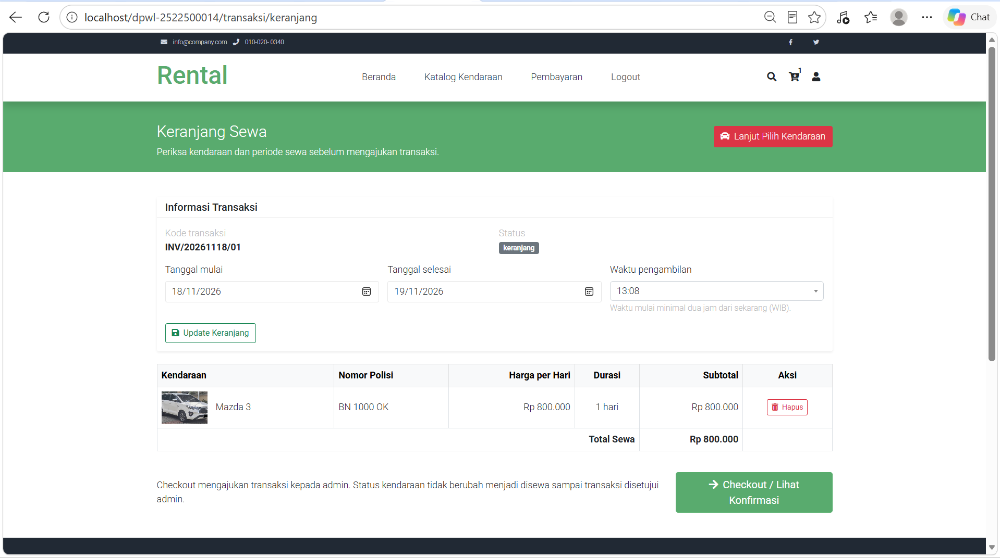
Hasil Pengujian Halaman Pembayaran 2 Tampilan halaman dp
   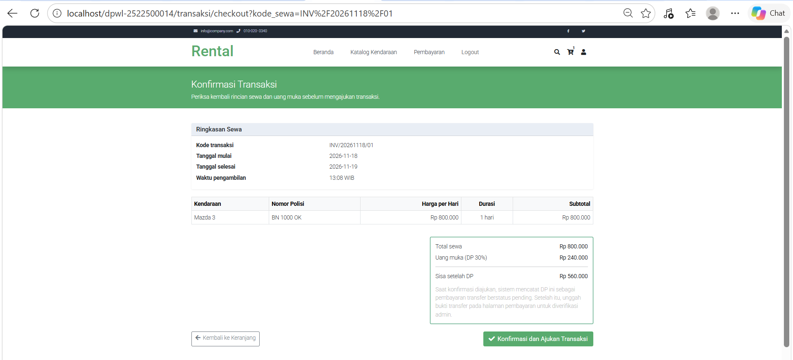
Hasil Pengujian Halaman Pembayaran 3 Form menggungah bukti DP
   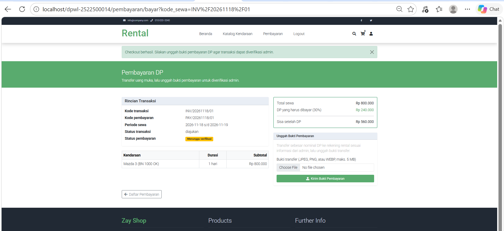
Hasil Pengujian Halaman Pembayaran 4 saat sudah upload bukti dp
   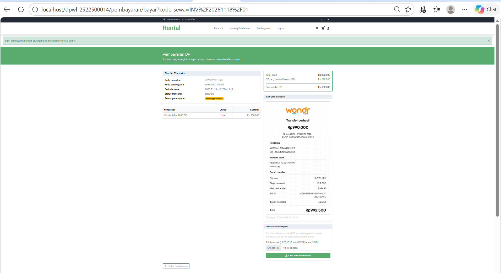
Hasil Pengujian Halaman Pembayaran 5 beralih ke daftar pembayaran
   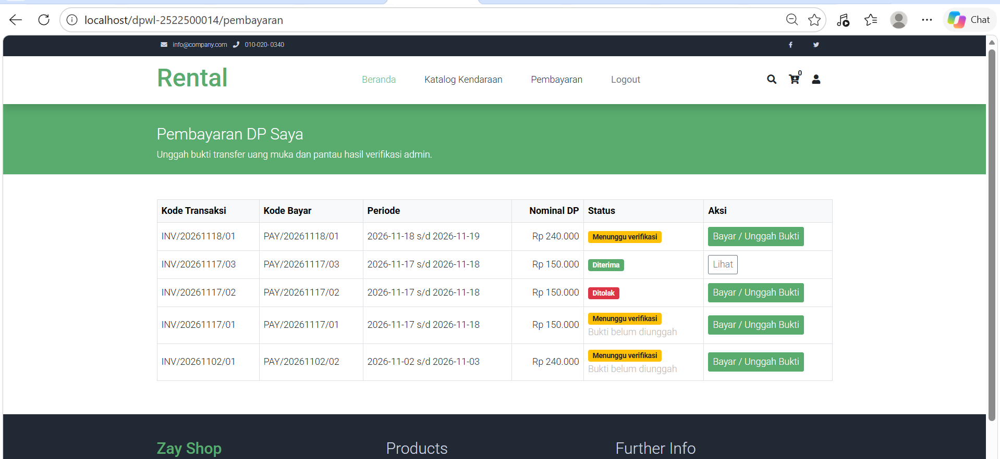
Hasil Pengujian Halaman Pembayaran 6 bila pembayaran dp diterima
   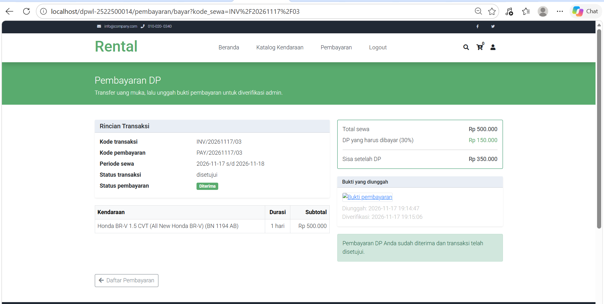
Hasil Pengujian Halaman Pembayaran 7 bila pembayaran dp ditolak
   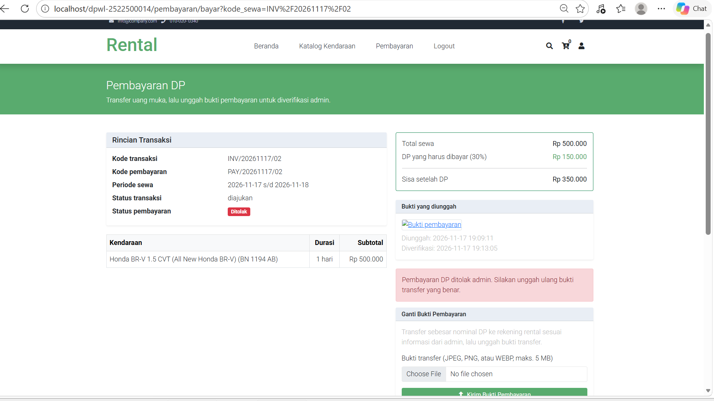
Hasil Pengujian Halaman Pembayaran 8 bukti dp harus di upload
   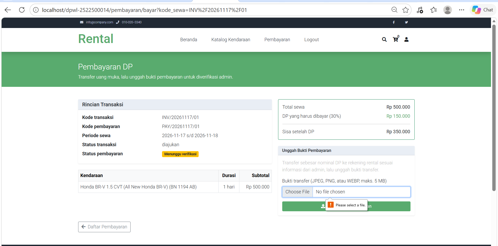
Hasil Pengujian Halaman Verifikasi Pembayaran 1 
   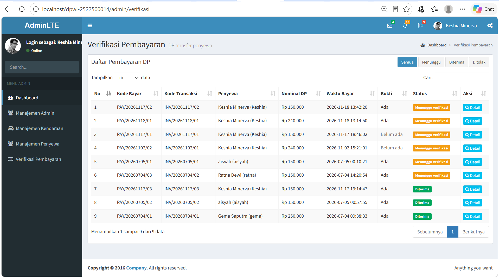
Hasil Pengujian Halaman Verifikasi Pembayaran 2 tampilan bila penyewa belum dp
   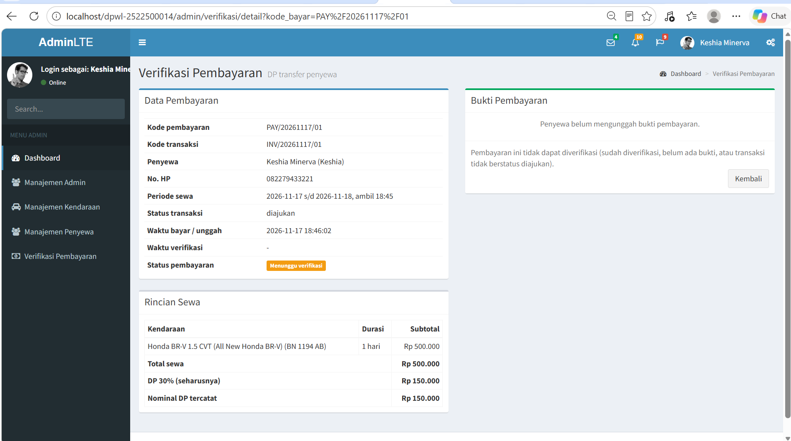
Hasil Pengujian Halaman Verifikasi Pembayaran 3 tampilan penyewa sudah dp
   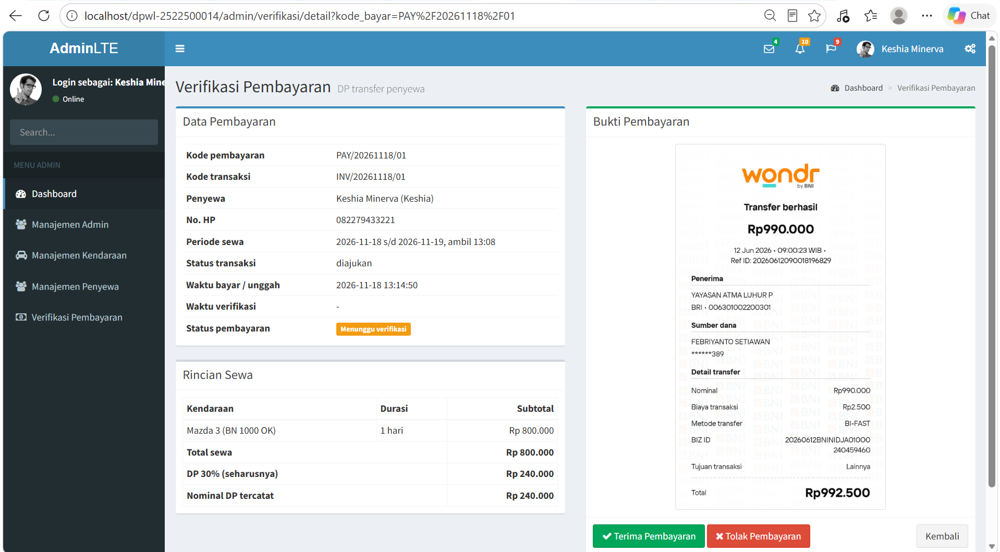
Hasil Pengujian Halaman Verifikasi Pembayaran 4 tampilan bila pembayaran ditolak
   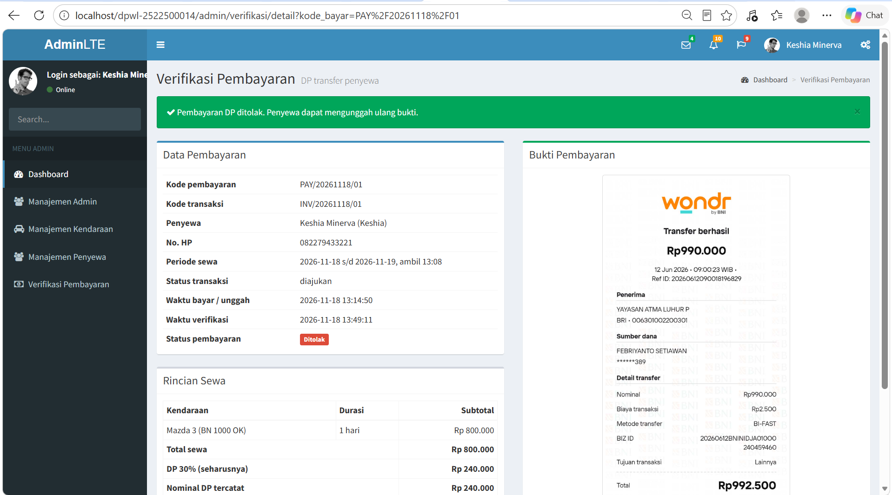
Hasil Pengujian Halaman Verifikasi Pembayaran 5 tampilan bila pembayaran dp diterima
   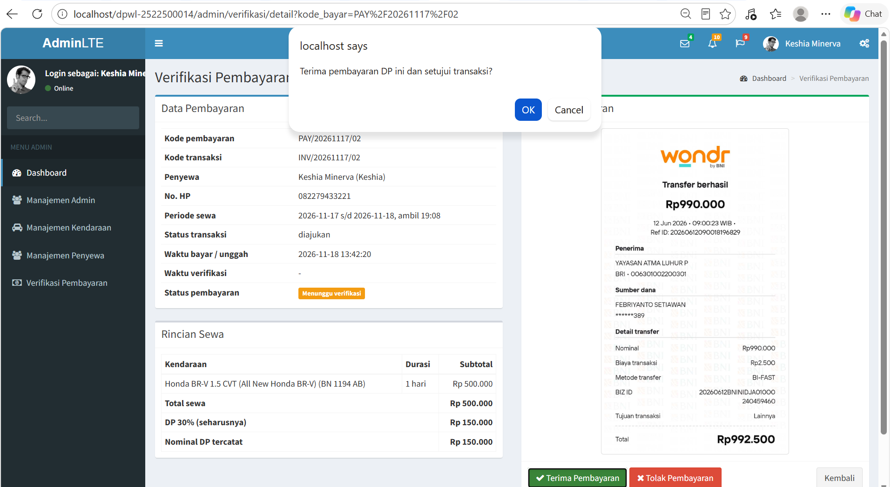
Hasil Pengujian Halaman Verifikasi Pembayaran 6 tampilan bila pembayaran dp diterima
   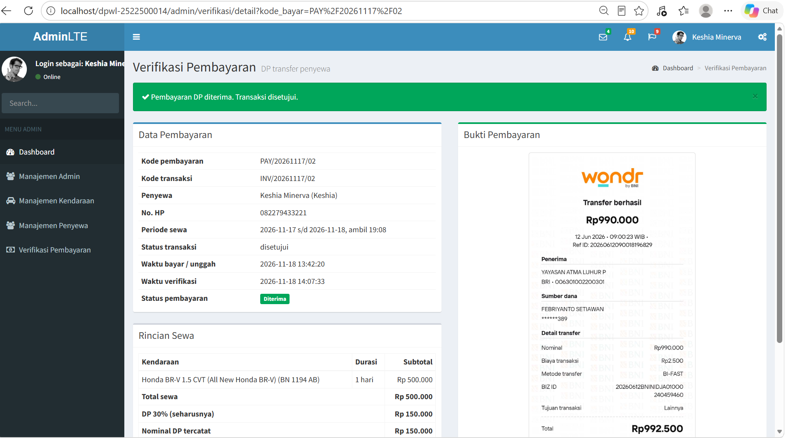

