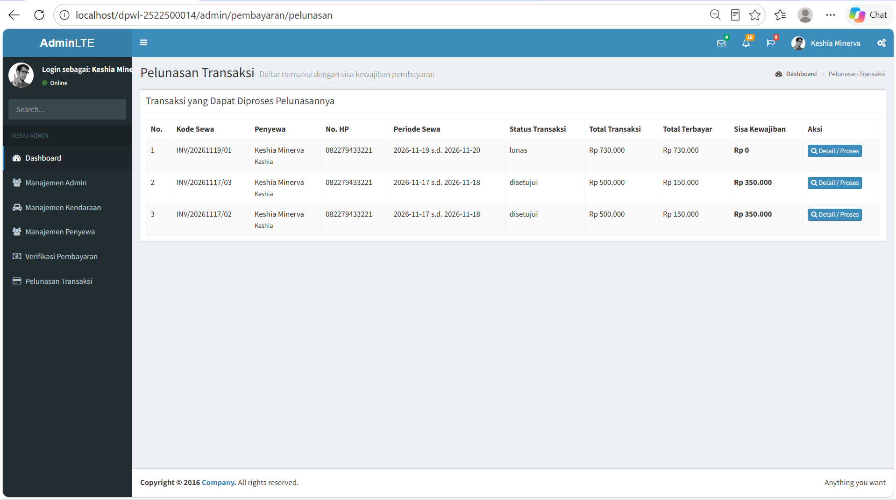
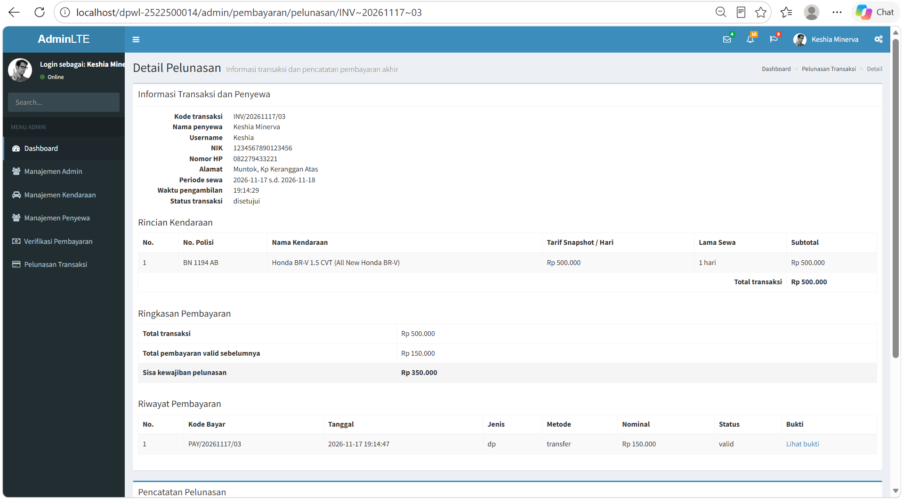
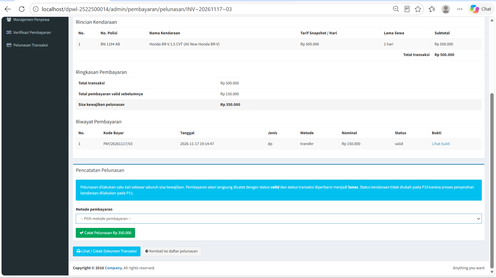
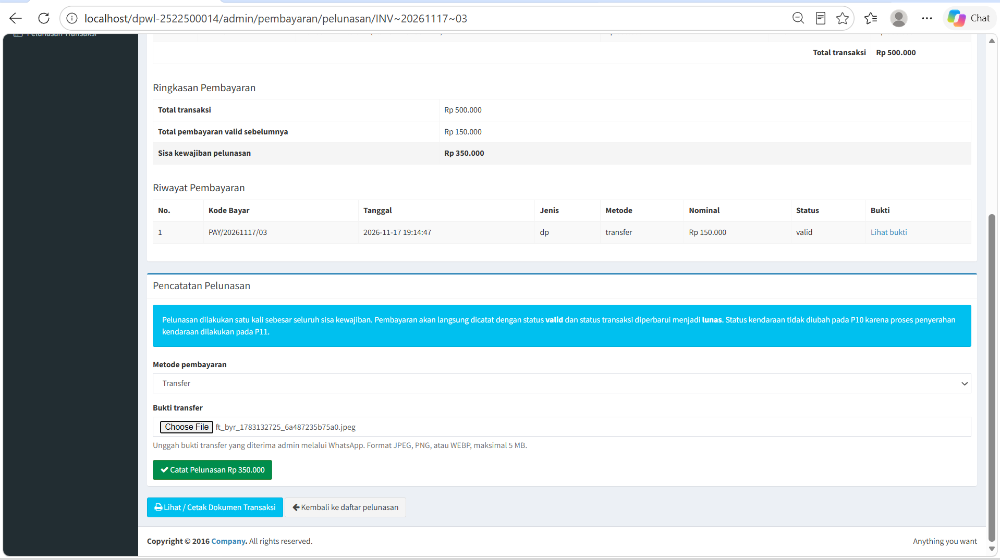
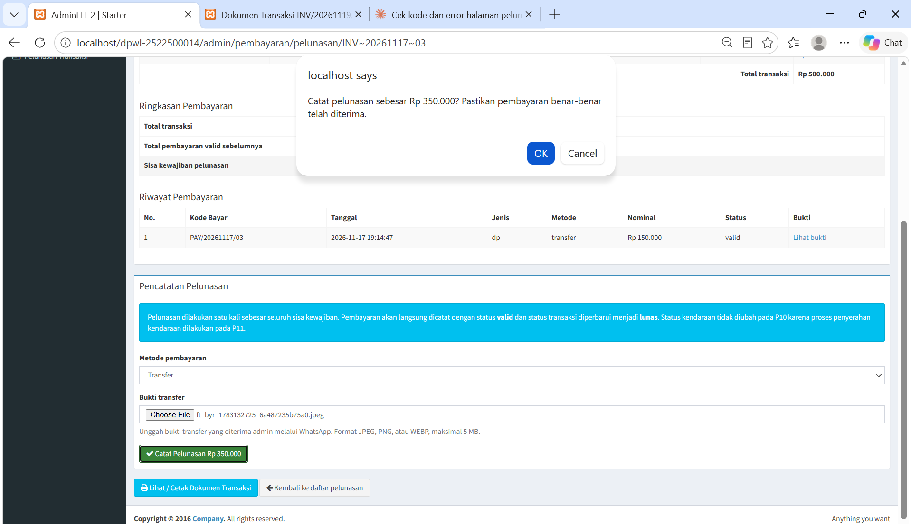
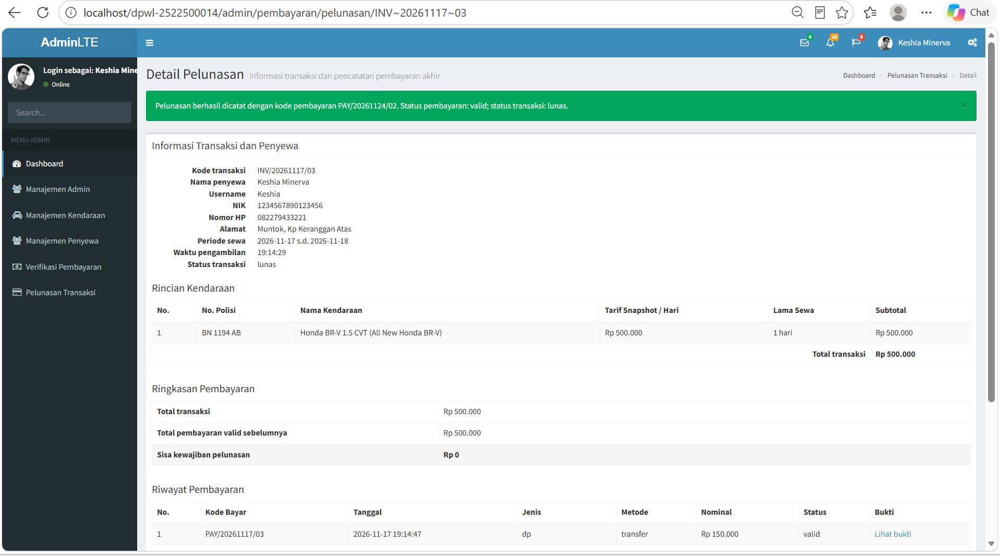
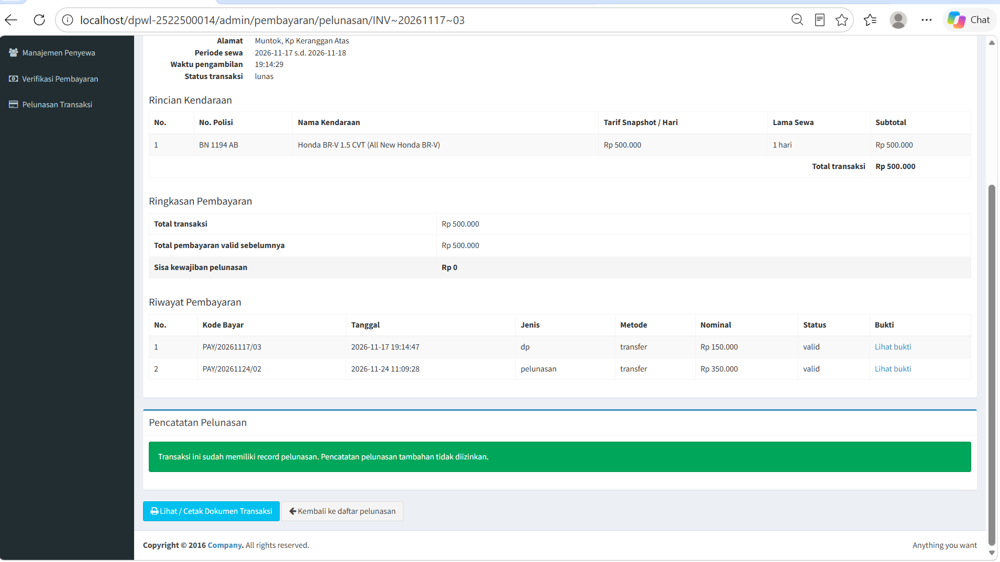
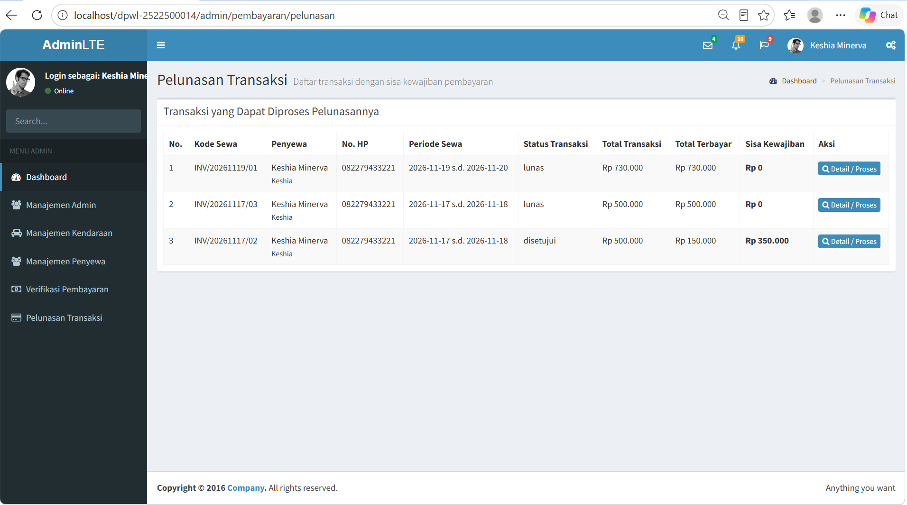
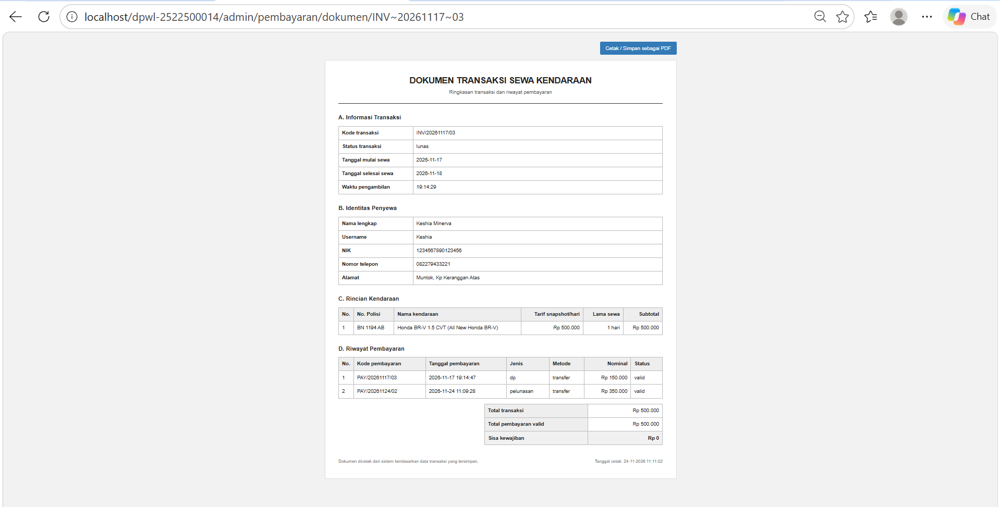

# pertemuan-10

HASIL PENGUJIAN P10:

1. Hasil Pengujian Halaman Pelunasan 1
   
2. Hasil Pengujian Halaman Pelunasan Detail 1
   
3. Hasil Pengujian Halaman Pelunasan Detail 2
   
4. Hasil Pengujian Halaman Pelunasan Detail 3 saat metode pembayaran yag dipilih adalah metode transfer, maka akan diminta bukti transfer
   
5. Hasil Pengujian Halaman Pelunasan Detail 4 saat pelunasan di catat akan muncul notifikasi konfirmasi pelunasan benar dilakukan
   
6. Hasil Pengujian Halaman Pelunasan Detail 5 saat pelunasan sudah di konfirmasi
   
   
7. Hasil Pengujian Halaman Pelunasan Detail 6 tampilan halaman pelunasan saat pelunasan sudah di lakukan, maka sisa kewajiban sisa 0 rupiah
   
8. Hasil Pengujian Dokumen transaksi yang bisa di cetak
   

Pada bagian B sudah ditambahkan nilai lunas pada kolom status_sewa di tabel t_sewa.
Berkas yang ditambah atau diubah:

Diubah:

application/models/Pembayaran_model.php (tambah 4 method P10)
application/controllers/Pembayaran_controller.php (tambah 4 method P10 dan perbaikan nama properti, lihat bagian kendala)
application/config/routes.php (4 route pelunasan dan dokumen)
application/views/templates/sidebar.php (menu Pelunasan Transaksi)

Ditambah:

application/views/admin/pelunasan.php
application/views/admin/pelunasan_detail.php
application/views/admin/dokumen_transaksi.php
